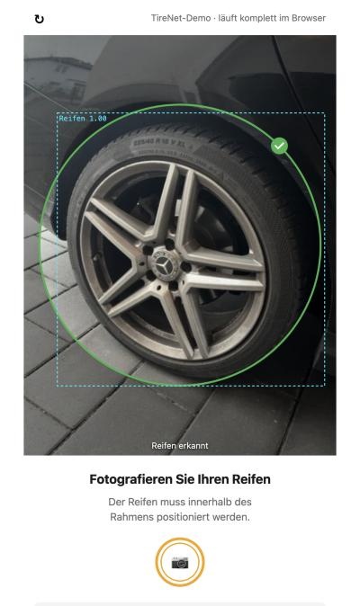
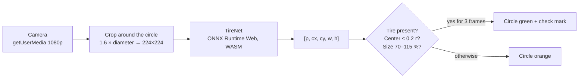

# TireNet – Live Tire Detection in the Browser

**English** · [Deutsch](README.de.md)

This repo shows two things:

1. **A custom image recognition model, trained with the help of AI.** Claude Code selected the training data,
   built, trained and evaluated the model. License-clean, without any prior machine learning experience, in just
   over 30 minutes.
2. **How that model runs on a website.** It is a single file (4.3 MB), executed directly in the browser with a few
   lines of JavaScript. No server, no app, and no image ever leaves the device.

The use case: a circle in the camera view turns green as soon as a tire sits correctly inside it.

<p align="center"></p>

> **Status:** Feasibility demo, not for production. See the limitations further down.
> The demo UI is in German, as it was built for a German-speaking client project.

---

## Contents

1. [Try it](#try-it)
2. [Background](#background)
3. [The journey – and what Claude Code did](#the-journey)
4. **Part 1 – Training the model**
   - [What the AI did for the training](#what-the-ai-did-for-the-training)
   - [The model](#the-model) · [Training data](#training-data) · [Results](#results) · [Train it yourself](#train-it-yourself)
5. **Part 2 – The model on the website**
   - [From model to website in three steps](#from-model-to-website-in-three-steps)
   - [How the demo page works](#how-the-demo-page-works)
6. [Limitations and open points](#limitations-and-open-points) · [Project structure](#project-structure) · [Licenses and sources](#licenses-and-sources)

---

## Try it

**Online:** open **<https://ifahrentholz.de/tirenet-browser-demo/>** on your phone, then tap "Kamera starten"
(start camera) and point the phone at a car wheel. On desktop, use the example photos or upload your own.

**Locally:**

```bash
node server.mjs          # http://localhost:8080
```

To test with a phone on the same Wi-Fi, the page needs HTTPS, otherwise the browser won't grant camera access.
Create a self-signed certificate once; `server.mjs` then also opens port 8443:

```bash
mkdir -p cert && openssl req -x509 -newkey rsa:2048 -nodes -days 30 \
  -keyout cert/key.pem -out cert/cert.pem -subj "/CN=tirenet-demo" \
  -addext "subjectAltName=IP:$(ipconfig getifaddr en0),DNS:localhost"
node server.mjs          # phone: https://<LAN-IP>:8443 → accept the certificate warning
```

The debug panel below the shutter button shows inference time, FPS, confidence and the deviation from center and size.

---

## Background

A client project in tire retail: users should photograph their tire on the **website** (not in an app). The photo
is then sent to a recognition service that reads tire size, DOT number etc. The design requires:

1. **Camera view and custom website UI at the same time.** The camera runs in one area of the page, surrounded by
   headline, text and shutter button.
2. **Live feedback.** A circle shows where the tire should be. Once the tire is positioned correctly, the circle
   turns **green with a check mark**.

Point 1 is standard web (`getUserMedia`, `<video>` plus an SVG overlay). Point 2 was the interesting part: the
recognition service takes 3–12 seconds per photo in the cloud. Live feedback at 10+ frames per second therefore
requires recognition **on the device**.

## The journey

Everything happened in a single Claude Code session. Times are taken from the session log.

| Time | Input to Claude (paraphrased) | What Claude Code did |
| --- | --- | --- |
| 13:30 | "Check the ticket for feasibility: camera plus custom UI, circle turns green when the tire is inside." | Read the ticket via CLI, analyzed the recognition service's API docs, summarized feasibility and risks. Result: live detection needs a small model in the browser. |
| 15:10 | "Do a web search – surely such a model already exists?" | Result: there are models with a "Tire" class (Open Images V7). But the ready-made ones are **AGPL-3.0** (Ultralytics), which is problematic for a commercial shop frontend. |
| 15:18 | "Yes, prototype first." | Built a test page with camera, circle mask and YOLOv8n via ONNX Runtime Web, plus a local HTTPS server. |
| 15:28 | Sent back iPhone screenshots | **Running on the iPhone 10 minutes later:** ~50 ms per frame, ~15 FPS, circle turns green. |
| 15:40 | "Here are the test photos from a real car." | Analyzed the photos and fine-tuned the center/size rule. |
| 16:12 | "There's a license problem. Does it make sense for you to train the model yourself?" → "Yes, go." | Data pipeline (Open Images), custom model, training, export and comparison with the AGPL model. |
| ~16:45 | – | **Custom model done and running in the browser:** 4.3 MB, ~5 ms per frame, license-clean. |
| next day | Test on the iPhone | Works. |

**The human part:** the requirement, the decisions (prototype first, then a custom model), testing on a real phone
and a real car, and raising the licensing question.
**What Claude Code did:** research, all of the code (web, data pipeline, training, export, evaluation), the training
itself and an honest evaluation, including where the custom model performs worse.

Not a single line was written by hand. No machine learning background was needed to judge the results either:
Claude put the metrics into context and proposed stop criteria.

---

# Part 1 – Training the model

## What the AI did for the training

The instruction to Claude Code boiled down to one sentence, *"Does it make sense for you to train the model
yourself?"*, followed by *"Yes, go."* Claude handled the rest on its own, explaining intermediate results and
decisions along the way:

1. **Narrow down the problem.** Instead of a general object detector, a model that only looks at the crop around
   the circle and answers "tire yes/no, and where exactly" is enough. That makes it small, fast and easy to train.
2. **Get the data.** A freely licensed dataset with tire annotations (Open Images) was selected, plus deliberate
   "traps": round things like clocks, plates or pizzas, so that not everything round turns green. A script
   downloads the images (`fetch_data.py`).
3. **Generate training examples.** Crops are generated from the photos that recreate the "phone in front of a
   wheel" situation. A third of them are deliberately borderline cases (tire slightly too big, slightly off-center).
4. **Build and train the model.** A pre-trained MobileNetV3-Small with a custom output head, trained in ~20 minutes
   on a MacBook (`train.py`).
5. **Check the labels.** A grid of training examples with drawn boxes
   ([`docs/label-check.jpg`](docs/label-check.jpg)) confirms that the data is correct.
6. **Export** as an ONNX file for the browser (`export.py`), including a PyTorch ↔ ONNX cross-check.
7. **Evaluate.** The model was tested against a ready-made reference model and on real phone photos
   (`evaluate.py`). Claude openly pointed out the weaknesses.

Claude solved a few intermediate problems on its own along the way. For example, the first validation set contained
too few "green" cases to measure the green decision meaningfully. Claude noticed this and added the generation of
borderline cases.

## The model

[`train/train.py`](train/train.py), class `TireNet`:

| Part | Details |
| --- | --- |
| Backbone | torchvision **MobileNetV3-Small** (BSD-3), ImageNet pre-trained, fully fine-tuned |
| Head | AvgPool → Linear(576→256) → Hardswish → Dropout → Linear(256→5) |
| Input | RGB 224×224, values 0..1 (normalization is built into the model) |
| Output | `p` (sigmoid), `cx, cy` (−0.3…1.3, may extend beyond the crop), `w, h` (0…1.5), all relative to the crop |
| Loss | BCE for `p` + 5 × SmoothL1 for the box (positive examples only) |
| Training | AdamW + OneCycle, batch 64, 12 epochs × 12,000 crops, **~20 min on a MacBook M3 Pro (MPS)** |
| Export | ONNX opset 17, 4.3 MB, PyTorch↔ONNX deviation < 1e-6 |

## Training data

Source: [Open Images V7](https://storage.googleapis.com/openimages/web/index.html) (annotations CC BY 4.0, images CC BY 2.0).
[`train/fetch_data.py`](train/fetch_data.py) downloads:

| | Training | Validation |
| --- | --- | --- |
| Images with tire/wheel (box ≥ 15 % of image side, no groups, no depictions) | 5,000 | 1,198 |
| Images without any vehicle | 1,500 | 400 |
| "Hard" negatives: round things (clock, plate, ball, pizza, doughnut …) | 1,000 | 200 |

About 9,300 images in total, downscaled to max. 640 px, ~730 MB. The training examples are generated on the fly
during training: random square crops that recreate the "phone in front of a wheel" situation.

- 35 % crops around a tire with arbitrary size and offset
- 30 % **borderline cases:** tire almost fitting, slightly too big, slightly off. This is where green vs. orange is decided.
- 15 % random crops from tire images, 20 % from negative images
- Augmentation: flip, brightness, contrast, color, blur, black side bars (portrait video)

A visual spot check of the labels is in [`docs/label-check.jpg`](docs/label-check.jpg).

## Results

Evaluated with [`train/evaluate.py`](train/evaluate.py). The reference is a ready-made, publicly available model
(YOLOv8n on Open Images V7, AGPL-3.0) that ran in the first prototype. It is not included in this repo.

| | **TireNet (custom)** | YOLOv8n-OIV7 (reference) |
| --- | --- | --- |
| License | BSD-3 backbone + own training | AGPL-3.0 |
| Model size | **4.3 MB** | 14 MB |
| Inference CPU, 1 thread | **4.5 ms** | 37 ms |
| Inference browser (MacBook M3 Pro) | **~5 ms** (4 threads), ~7 ms (1 thread) | – |
| Inference browser (iPhone) | ⟨add values from iPhone test⟩ | ~50 ms, ~15 FPS |
| Tire present yes/no (3,000 validation crops) | **95.1 %** | 76.4 % |
| Box accuracy (mean IoU) | **0.68** | 0.55 |
| Green/orange decision correct | 93.9 % | **95.7 %** |
| Green although there is no tire at all (threshold 0.8) | **0** | 0 |
| Real phone photos, 3 variants each | 11/12 | **12/12** |

**An honest assessment:** the custom model is 8× faster, 3× smaller and detects tires much more reliably. On the
pure green decision it is slightly behind the reference. Almost all wrong decisions are **borderline cases**: the
tire is a few percent too big or just off-center. The single error on the real photos is exactly such a case
(size 1.16 instead of max. 1.15). For a positioning *hint* this is uncritical, and the tolerance can be tuned.

## Train it yourself

```bash
cd train
python3.12 -m venv .venv && .venv/bin/pip install -r requirements.txt
.venv/bin/python fetch_data.py     # annotations + ~9,300 images into train/data (~730 MB, a few minutes)
.venv/bin/python train.py 12       # 12 epochs, ~20 min on Apple Silicon (MPS), otherwise CPU/GPU
.venv/bin/python export.py         # → tirenet.onnx, copied to web/models/
.venv/bin/python evaluate.py       # metrics + real photos from train/realtest
```

---

# Part 2 – The model on the website

## From model to website in three steps

**1. Export:** the trained PyTorch model becomes a single file (`web/models/tirenet.onnx`, 4.3 MB):

```python
torch.onnx.export(model, torch.rand(1, 3, 224, 224), "tirenet.onnx",
                  input_names=["images"], output_names=["out"], opset_version=17)
```

**2. Load it in the browser:** [ONNX Runtime Web](https://onnxruntime.ai/docs/get-started/with-javascript/web.html)
runs the file via WebAssembly. No server, no framework; the file is simply served as a static asset:

```js
import * as ort from './vendor/ort.wasm.min.mjs';
const session = await ort.InferenceSession.create('./models/tirenet.onnx', { executionProviders: ['wasm'] });
```

**3. Run it on every camera frame:** draw the crop around the circle into a 224×224 canvas, write the pixels into a
float array and call the model. It returns five numbers (simplified):

```js
ctx.drawImage(video, sx, sy, side, side, 0, 0, 224, 224);           // crop around the circle
const input = new ort.Tensor('float32', toCHW(ctx.getImageData(0, 0, 224, 224)), [1, 3, 224, 224]);
const { out } = await session.run({ images: input });
const [p, cx, cy, w, h] = out.data;                                  // tire? + box within the crop
const ok = p >= 0.8 && centerNearCircle(cx, cy) && sizeFitsCircle(w, h);
ring.classList.toggle('ok', ok);                                     // circle turns green
```

This takes ~5 ms per frame and runs in a loop while the camera is on. The full code is in
[`web/app.js`](web/app.js) (~250 lines including camera, overlay and debug display).

**What this means for a real project:** the model is a static asset like an image or a font. It can be shipped via
the normal frontend build and CDN. Rolling out a new model means replacing one file. There is no cost per
detection, because everything runs on the user's device. On top of that comes the runtime itself: the ONNX Runtime
Web WebAssembly file is ~11 MB, but it is loaded only once and then cached. It makes sense to load it lazily, only
when the user opens the camera.

## How the demo page works



- **Camera and UI:** a `<video playsinline>` with `object-fit: cover` sits in a fixed area, with an SVG mask with a
  circular hole on top. `coverTransform()` in [`web/app.js`](web/app.js) converts coordinates between video and
  screen.
- **The trick that keeps the model so small:** a general object detector is not needed. The model only sees the
  square crop around the circle and answers exactly one question: *"Is there a tire here, and where exactly?"* That
  is one classification plus one box. No anchor boxes, no NMS, no 600 classes.
- **Decision:** green when the confidence is ≥ 0.8, the box center is at most 20 % of the radius away from the circle
  center, and the box is 70–115 % of the circle diameter. To avoid flickering, the state only changes after 3
  identical frames in a row.
- **Runtime:** [ONNX Runtime Web](https://onnxruntime.ai/) 1.22 (WASM). With COOP/COEP headers (`server.mjs`) it runs
  on 4 threads, on GitHub Pages on 1 thread. Both are fast enough.
- **Shutter:** saves the full camera frame as JPEG (1080p, ~400–650 KB). This is the image that would be sent to the
  recognition service.

---

## Limitations and open points

- **The training data are web photos**, not phone close-ups of wheels. A few hundred real photos would help most.
- **Only tested on iPhone and MacBook.** A mid-range Android device is still missing.
- **ImageNet pre-training:** the backbone weights come from training on ImageNet. Whether the ImageNet terms of use
  apply to derived weights is not clearly settled legally. Before production use, check with legal or pre-train
  the backbone without ImageNet.
- The model only says "tire present and positioned correctly", not "photo sharp enough to read the DOT number".
  Image quality (sharpness, lighting) would be a separate topic.

## Project structure

```
web/                 static demo page (also used for GitHub Pages)
  index.html, app.js   UI, camera, inference loop, green rule
  models/tirenet.onnx  the trained model
  vendor/              onnxruntime-web 1.22 (WASM)
  examples/            example photos
train/               data, training, export, evaluation (Python)
server.mjs           local server with COOP/COEP (multi-threaded WASM) and optional HTTPS
.github/workflows/   deployment of web/ to GitHub Pages
```

## Licenses and sources

- **Training data:** Open Images V7 by Google. Annotations [CC BY 4.0](https://creativecommons.org/licenses/by/4.0/),
  images [CC BY 2.0](https://creativecommons.org/licenses/by/2.0/) (according to Open Images; the authors are listed
  in the dataset's metadata). The images are not part of this repo; `fetch_data.py` downloads them.
- **Backbone:** torchvision MobileNetV3-Small, BSD-3-Clause. ImageNet weights: see limitations above.
- **Runtime:** onnxruntime-web 1.22.0, MIT (Microsoft).
- **Example photos** in `web/examples/` and `train/realtest/`: own photos.
- Code in this repo: ⟨choose a license⟩.
