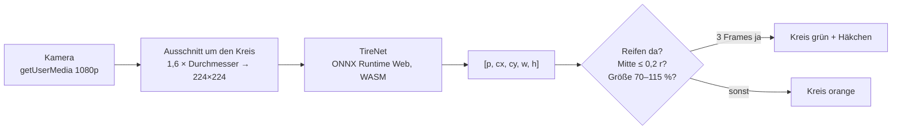

# TireNet – Reifenerkennung live im Browser

Dieses Repo zeigt zwei Dinge:

1. **Ein eigenes Bilderkennungsmodell, selbst trainiert mit Hilfe von KI.** Claude Code hat Trainingsdaten
   ausgewählt, das Modell gebaut, trainiert und ausgewertet. Das ging lizenzsauber, ohne ML-Vorwissen auf unserer
   Seite und in gut 30 Minuten.
2. **Wie dieses Modell auf einer Website läuft.** Es ist eine einzige Datei (4,3 MB) und wird mit ein paar
   Zeilen JavaScript direkt im Browser ausgeführt, ohne Server, ohne App und ohne dass ein Bild das Gerät verlässt.

Der Anwendungsfall: Ein Kreis im Kamerabild wird grün, sobald ein Reifen richtig darin sitzt.

<p align="center"></p>

> **Status:** Machbarkeits-Demo, nicht für Produktion. Die Grenzen stehen weiter unten.

---

## Inhalt

1. [Ausprobieren](#ausprobieren)
2. [Ausgangslage](#ausgangslage)
3. [Der Weg – und was Claude Code dabei gemacht hat](#der-weg)
4. **Teil 1 – Das Modell selbst trainieren**
   - [Was die KI dafür gemacht hat](#was-die-ki-für-das-training-gemacht-hat)
   - [Das Modell](#das-modell) · [Trainingsdaten](#trainingsdaten) · [Ergebnisse](#ergebnisse) · [Selbst trainieren](#selbst-trainieren)
5. **Teil 2 – Das Modell auf der Website**
   - [Vom Modell zur Website in drei Schritten](#vom-modell-zur-website-in-drei-schritten)
   - [Wie die Demo-Seite funktioniert](#wie-die-demo-seite-funktioniert)
6. [Grenzen und offene Punkte](#grenzen-und-offene-punkte) · [Projektstruktur](#projektstruktur) · [Lizenzen und Quellen](#lizenzen-und-quellen)

---

## Ausprobieren

**Online:** **<https://ifahrentholz.de/tirenet-browser-demo/>** auf dem Handy öffnen, dann „Kamera starten“.
Das Handy auf ein Autorad richten. Am Desktop gehen die Beispielfotos oder ein eigenes Foto.

**Lokal:**

```bash
node server.mjs          # http://localhost:8080
```

Für den Test mit dem Handy im gleichen WLAN braucht die Seite HTTPS, sonst gibt der Browser die Kamera nicht frei.
Dafür einmal ein selbstsigniertes Zertifikat erzeugen. Danach öffnet `server.mjs` zusätzlich Port 8443:

```bash
mkdir -p cert && openssl req -x509 -newkey rsa:2048 -nodes -days 30 \
  -keyout cert/key.pem -out cert/cert.pem -subj "/CN=tirenet-demo" \
  -addext "subjectAltName=IP:$(ipconfig getifaddr en0),DNS:localhost"
node server.mjs          # Handy: https://<LAN-IP>:8443 → Zertifikatswarnung bestätigen
```

Das Debug-Panel unter dem Auslöser zeigt Inferenzzeit, FPS, Konfidenz sowie Abweichung von Mitte und Größe.

---

## Ausgangslage

Ein Kundenprojekt im Reifenhandel: Nutzer sollen auf der **Website** (keine App) ihren Reifen fotografieren.
Das Foto geht dann an einen Erkennungsdienst, der Reifengröße, DOT-Nummer usw. ausliest. Das Design verlangt:

1. **Kamerabild und eigenes Website-UI gleichzeitig.** Die Kamera läuft in einem Bereich der Seite, darum herum
   Überschrift, Text und Auslöser.
2. **Live-Feedback.** Ein Kreis zeigt, wo der Reifen hin soll. Sitzt der Reifen richtig, wird der Kreis **grün
   mit Häkchen**.

Punkt 1 ist Standard-Web (`getUserMedia`, `<video>` plus SVG-Overlay). Spannend war Punkt 2: Der
Erkennungsdienst braucht pro Foto 3–12 Sekunden in der Cloud. Für ein Live-Feedback mit 10+ Bildern pro Sekunde
muss die Erkennung also **auf dem Gerät** laufen.

## Der Weg

Alles passierte in einer einzigen Claude-Code-Sitzung. Die Uhrzeiten stammen aus dem Sitzungsprotokoll.

| Zeit | Unser Input (sinngemäß) | Was Claude Code gemacht hat |
| --- | --- | --- |
| 13:30 | „Prüf das Ticket auf Machbarkeit: Kamera plus eigenes UI, Kreis wird grün, wenn der Reifen drin ist.“ | Ticket per CLI gelesen, API-Doku des Erkennungsdienstes ausgewertet, Machbarkeit und Risiken zusammengefasst. Ergebnis: Live-Erkennung braucht ein kleines Modell im Browser. |
| 15:10 | „Mach mal eine Webrecherche, ob es so ein Modell nicht schon gibt.“ | Ergebnis: Es gibt Modelle mit der Klasse „Tire“ (Open Images V7). Die fertigen sind aber **AGPL-3.0** (Ultralytics) und damit für ein kommerzielles Shop-Frontend problematisch. |
| 15:18 | „Ja, Prototyp zuerst.“ | Testseite mit Kamera, Kreismaske und YOLOv8n per ONNX Runtime Web gebaut, lokaler HTTPS-Server dazu. |
| 15:28 | iPhone-Screenshots zurückgeschickt | **10 Minuten später lief es auf dem iPhone:** ~50 ms pro Bild, ~15 FPS, Kreis wird grün. |
| 15:40 | „Hier die Testbilder vom echten Auto.“ | Fotos ausgewertet und die Regel für Mitte und Größe nachjustiert. |
| 16:12 | „Wir haben ein Lizenzproblem. Macht es Sinn, dass du das Modell selbst trainierst?“ → „Ja, starten.“ | Daten-Pipeline (Open Images), eigenes Modell, Training, Export und Vergleich mit dem AGPL-Modell. |
| ~16:45 | – | **Eigenes Modell fertig und im Browser:** 4,3 MB, ~5 ms pro Bild, lizenzsauber. |
| nächster Tag | Test auf dem iPhone | Funktioniert. |

**Was wir Menschen beigetragen haben:** die Anforderung, die Entscheidungen (Prototyp zuerst, dann eigenes Modell),
die Tests am echten Handy und am echten Auto sowie die Frage nach den Lizenzen.
**Was Claude Code gemacht hat:** Recherche, sämtlicher Code (Web, Datenpipeline, Training, Export, Auswertung),
das Training selbst und die ehrliche Auswertung, inklusive der Stellen, an denen das eigene Modell schlechter ist.

Es wurde keine Zeile von Hand geschrieben. ML-Vorwissen war nicht nötig, um die Ergebnisse zu bewerten:
Claude hat die Kennzahlen eingeordnet und Abbruchkriterien vorgeschlagen.

---

# Teil 1 – Das Modell selbst trainieren

## Was die KI für das Training gemacht hat

Unser Auftrag an Claude Code war im Kern ein Satz: *„Macht es Sinn, dass du das Modell selbst trainierst?“* und
danach *„Ja, starten.“* Den Rest hat Claude selbstständig erledigt und dabei Zwischenergebnisse und Entscheidungen
erklärt:

1. **Problem eingrenzen.** Statt eines allgemeinen Objektdetektors genügt ein Modell, das nur den Ausschnitt um
   den Kreis sieht und sagt: „Reifen ja/nein, und wo genau“. Das macht es klein, schnell und leicht zu trainieren.
2. **Daten beschaffen.** Ein frei lizenzierter Datensatz mit Reifen-Annotationen (Open Images) wurde ausgewählt.
   Dazu kamen gezielt „Fallen“, also runde Dinge wie Uhren, Teller oder Pizzen, damit nicht alles Runde grün wird.
   Ein Skript lädt die Bilder (`fetch_data.py`).
3. **Trainingsbeispiele erzeugen.** Aus den Fotos werden Ausschnitte erzeugt, die die Situation „Handy vor Rad“
   nachstellen. Ein Drittel davon sind bewusst Grenzfälle (Reifen knapp zu groß, knapp daneben).
4. **Modell bauen und trainieren.** Ein vortrainiertes MobileNetV3-Small mit eigenem Ausgabekopf, trainiert in
   ~20 Minuten auf dem MacBook (`train.py`).
5. **Labels prüfen.** Ein Bildraster der Trainingsbeispiele mit eingezeichneten Boxen
   ([`docs/label-check.jpg`](docs/label-check.jpg)) bestätigt, dass die Daten stimmen.
6. **Exportieren** als ONNX-Datei für den Browser (`export.py`), inklusive Gegenprobe PyTorch ↔ ONNX.
7. **Auswerten.** Das Modell wurde gegen ein fertiges Referenzmodell und an echten Handyfotos getestet
   (`evaluate.py`). Die Schwächen hat Claude dabei offen benannt.

Ein paar Zwischenprobleme hat Claude unterwegs selbst gelöst. Zum Beispiel enthielt der erste
Validierungsdatensatz zu wenige Grün-Fälle, um die Grün-Entscheidung sinnvoll zu messen. Claude hat das bemerkt
und die Erzeugung der Grenzfälle ergänzt.

## Das Modell

[`train/train.py`](train/train.py), Klasse `TireNet`:

| Teil | Details |
| --- | --- |
| Backbone | torchvision **MobileNetV3-Small** (BSD-3), ImageNet-vortrainiert, ganz feinjustiert |
| Kopf | AvgPool → Linear(576→256) → Hardswish → Dropout → Linear(256→5) |
| Eingabe | RGB 224×224, Werte 0..1 (Normalisierung steckt im Modell) |
| Ausgabe | `p` (Sigmoid), `cx, cy` (−0,3…1,3, darf aus dem Bild ragen), `w, h` (0…1,5), alles relativ zum Ausschnitt |
| Loss | BCE für `p` + 5 × SmoothL1 für die Box (nur bei positiven Beispielen) |
| Training | AdamW + OneCycle, Batch 64, 12 Epochen × 12.000 Ausschnitte, **~20 min auf einem MacBook M3 Pro (MPS)** |
| Export | ONNX opset 17, 4,3 MB, Abweichung PyTorch↔ONNX < 1e-6 |

## Trainingsdaten

Quelle: [Open Images V7](https://storage.googleapis.com/openimages/web/index.html) (Annotationen CC BY 4.0, Bilder CC BY 2.0).
[`train/fetch_data.py`](train/fetch_data.py) lädt:

| | Training | Validierung |
| --- | --- | --- |
| Bilder mit Reifen/Rad (Box ≥ 15 % der Bildseite, keine Gruppen, keine Zeichnungen) | 5.000 | 1.198 |
| Bilder ohne Fahrzeugbezug | 1.500 | 400 |
| „harte“ Negative: runde Dinge (Uhr, Teller, Ball, Pizza, Donut …) | 1.000 | 200 |

Insgesamt ~9.300 Bilder, auf max. 640 px verkleinert, ~730 MB. Die Trainingsbeispiele entstehen erst beim
Training: zufällige quadratische Ausschnitte, die die Situation „Handy vor Rad“ nachstellen.

- 35 % Ausschnitte um einen Reifen mit beliebiger Größe und Verschiebung
- 30 % **Grenzfälle:** Reifen fast passend, knapp zu groß, knapp daneben. Hier entscheidet sich grün oder orange.
- 15 % zufällige Ausschnitte aus Reifenbildern, 20 % aus Negativbildern
- Augmentierung: Spiegeln, Helligkeit, Kontrast, Farbe, Unschärfe, schwarze Seitenbalken (Hochformat-Video)

Eine Kontrolle der Labels per Augenschein liegt in [`docs/label-check.jpg`](docs/label-check.jpg).

## Ergebnisse

Auswertung mit [`train/evaluate.py`](train/evaluate.py). Als Referenz dient ein fertiges, öffentlich verfügbares
Modell (YOLOv8n auf Open Images V7, AGPL-3.0), das im Prototyp zuerst lief. Es ist nicht in diesem Repo enthalten.

| | **TireNet (eigenes)** | YOLOv8n-OIV7 (Referenz) |
| --- | --- | --- |
| Lizenz | BSD-3-Backbone + eigenes Training | AGPL-3.0 |
| Modellgröße | **4,3 MB** | 14 MB |
| Inferenz CPU, 1 Thread | **4,5 ms** | 37 ms |
| Inferenz Browser (MacBook M3 Pro) | **~5 ms** (4 Threads), ~7 ms (1 Thread) | – |
| Inferenz Browser (iPhone) | ⟨Werte vom iPhone-Test eintragen⟩ | ~50 ms, ~15 FPS |
| Reifen erkannt ja/nein (3.000 Validierungsausschnitte) | **95,1 %** | 76,4 % |
| Box-Genauigkeit (mittlere IoU) | **0,68** | 0,55 |
| Entscheidung grün/orange korrekt | 93,9 % | **95,7 %** |
| Grün, obwohl gar kein Reifen da ist (Schwelle 0,8) | **0** | 0 |
| Echte Handyfotos, je 3 Varianten | 11/12 | **12/12** |

**Ehrlich eingeordnet:** Das eigene Modell ist 8× schneller, 3× kleiner und erkennt Reifen deutlich zuverlässiger.
Bei der reinen Grün-Entscheidung liegt es knapp hinter der Referenz. Fast alle Fehlentscheidungen sind
**Grenzfälle**: Der Reifen ist ein paar Prozent zu groß oder knapp neben der Mitte. Der eine Fehler bei den echten
Fotos ist genau so ein Fall (Größe 1,16 statt max. 1,15). Für einen Positionierungs*hinweis* ist das unkritisch,
und an der Toleranz lässt sich drehen.

## Selbst trainieren

```bash
cd train
python3.12 -m venv .venv && .venv/bin/pip install -r requirements.txt
.venv/bin/python fetch_data.py     # Annotationen + ~9.300 Bilder nach train/data (~730 MB, ein paar Minuten)
.venv/bin/python train.py 12       # 12 Epochen, ~20 min auf Apple Silicon (MPS), sonst CPU/GPU
.venv/bin/python export.py         # → tirenet.onnx, kopiert nach web/models/
.venv/bin/python evaluate.py       # Kennzahlen + echte Fotos aus train/realtest
```

---

# Teil 2 – Das Modell auf der Website

## Vom Modell zur Website in drei Schritten

**1. Exportieren:** Das trainierte PyTorch-Modell wird eine einzige Datei (`web/models/tirenet.onnx`, 4,3 MB):

```python
torch.onnx.export(model, torch.rand(1, 3, 224, 224), "tirenet.onnx",
                  input_names=["images"], output_names=["out"], opset_version=17)
```

**2. Im Browser laden:** [ONNX Runtime Web](https://onnxruntime.ai/docs/get-started/with-javascript/web.html)
führt die Datei per WebAssembly aus. Es braucht keinen Server und kein Framework, die Datei wird einfach statisch
mit ausgeliefert:

```js
import * as ort from './vendor/ort.wasm.min.mjs';
const session = await ort.InferenceSession.create('./models/tirenet.onnx', { executionProviders: ['wasm'] });
```

**3. Pro Kamerabild ausführen:** Den Ausschnitt um den Kreis in ein 224×224-Canvas zeichnen, die Pixel in ein
Float-Array schreiben und das Modell aufrufen. Zurück kommen fünf Zahlen (vereinfacht):

```js
ctx.drawImage(video, sx, sy, side, side, 0, 0, 224, 224);           // Ausschnitt um den Kreis
const input = new ort.Tensor('float32', toCHW(ctx.getImageData(0, 0, 224, 224)), [1, 3, 224, 224]);
const { out } = await session.run({ images: input });
const [p, cx, cy, w, h] = out.data;                                  // Reifen? + Box im Ausschnitt
const ok = p >= 0.8 && centerNearCircle(cx, cy) && sizeFitsCircle(w, h);
ring.classList.toggle('ok', ok);                                     // Kreis grün
```

Das dauert ~5 ms pro Bild und läuft in einer Schleife, solange die Kamera an ist. Der vollständige Code steht in
[`web/app.js`](web/app.js) (~250 Zeilen inklusive Kamera, Overlay und Debug-Anzeige).

**Was das für ein echtes Projekt bedeutet:** Das Modell ist ein statisches Asset wie ein Bild oder ein Font. Es
kann über den normalen Frontend-Build und das CDN ausgeliefert werden. Ein neues Modell einzuspielen heißt, eine
Datei auszutauschen. Kosten pro Erkennung fallen nicht an, weil alles auf dem Gerät des Nutzers läuft.
Dazu kommt die Laufzeit selbst: Die WebAssembly-Datei von ONNX Runtime Web ist ~11 MB groß, wird aber nur
einmal geladen und dann gecacht. Sinnvoll ist es, sie erst nachzuladen, wenn der Nutzer die Kamera öffnet.

## Wie die Demo-Seite funktioniert



- **Kamera und UI:** `<video playsinline>` mit `object-fit: cover` liegt in einem festen Bereich, darüber eine SVG-Maske
  mit Kreisloch. Die Koordinaten zwischen Video und Bildschirm rechnet `coverTransform()` in
  [`web/app.js`](web/app.js) um.
- **Der Trick, der das Modell so klein macht:** Wir brauchen keinen allgemeinen Objektdetektor. Das Modell sieht
  nur den quadratischen Ausschnitt um den Kreis und beantwortet genau eine Frage: *„Ist hier ein Reifen, und wo
  genau?“* Das ist eine Klassifikation plus eine Box. Keine Anchor-Boxen, kein NMS, keine 600 Klassen.
- **Entscheidung:** Grün, wenn die Konfidenz ≥ 0,8 ist, die Box-Mitte höchstens 20 % des Radius von der
  Kreismitte entfernt liegt und die Box 70–115 % des Kreisdurchmessers groß ist. Damit nichts flackert, wechselt
  der Zustand erst nach 3 gleichen Frames in Folge.
- **Laufzeit:** [ONNX Runtime Web](https://onnxruntime.ai/) 1.22 (WASM). Mit COOP/COEP-Headern (`server.mjs`) läuft
  es mit 4 Threads, auf GitHub Pages mit 1 Thread. Beides ist schnell genug.
- **Auslöser:** Speichert das volle Kamerabild als JPEG (1080p, ~400–650 KB). Dieses Bild würde an den
  Erkennungsdienst gehen.

---

## Grenzen und offene Punkte

- **Trainingsdaten sind Web-Fotos**, keine Handy-Nahaufnahmen von Rädern. Ein paar hundert echte Fotos würden am
  meisten bringen.
- **Getestet nur auf iPhone und MacBook.** Ein Android-Gerät der Mittelklasse fehlt noch.
- **ImageNet-Vortraining:** Die Backbone-Gewichte stammen aus einem Training auf ImageNet. Ob die
  ImageNet-Nutzungsbedingungen die abgeleiteten Gewichte betreffen, ist rechtlich nicht eindeutig geklärt. Vor
  einem produktiven Einsatz also kurz mit Legal klären oder das Backbone ohne ImageNet vortrainieren.
- Das Modell sagt nur „Reifen da und richtig positioniert“, nicht „Foto scharf genug, um die DOT-Nummer zu lesen“.
  Bildqualität (Schärfe, Licht) wäre ein eigenes Thema.

## Projektstruktur

```
web/                 statische Demo-Seite (auch für GitHub Pages)
  index.html, app.js   UI, Kamera, Inferenz-Schleife, Grün-Regel
  models/tirenet.onnx  das trainierte Modell
  vendor/              onnxruntime-web 1.22 (WASM)
  examples/            Beispielfotos
train/               Daten, Training, Export, Auswertung (Python)
server.mjs           lokaler Server mit COOP/COEP (Multi-Thread-WASM) und optional HTTPS
.github/workflows/   Deployment von web/ auf GitHub Pages
```

## Lizenzen und Quellen

- **Trainingsdaten:** Open Images V7 von Google. Annotationen [CC BY 4.0](https://creativecommons.org/licenses/by/4.0/),
  Bilder [CC BY 2.0](https://creativecommons.org/licenses/by/2.0/) (laut Open Images; die Urheber stehen in den
  Metadaten des Datensatzes). Die Bilder liegen nicht im Repo, `fetch_data.py` lädt sie.
- **Backbone:** torchvision MobileNetV3-Small, BSD-3-Clause. ImageNet-Gewichte: siehe Grenzen oben.
- **Laufzeit:** onnxruntime-web 1.22.0, MIT (Microsoft).
- **Beispielfotos** in `web/examples/` und `train/realtest/`: eigene Aufnahmen.
- Der Code dieses Repos: ⟨Lizenz festlegen⟩.
